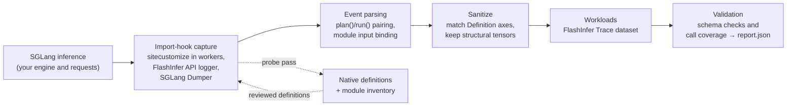

# fib-workload-capture

fib-workload-capture records the operator calls a model actually executes during SGLang (or vLLM)
inference and turns them into [FlashInfer-Bench](https://github.com/flashinfer-ai/flashinfer-bench)
workloads: Definition files plus the input shapes, structural tensors (indptrs, indices) and
scalars observed at runtime. Kernel benchmarks and kernel-optimization agents need workloads
that reflect real serving traffic, and collecting them by hand means instrumenting every model
and every kernel. Here you wrap your own inference code in `capture()`, then call `export()` to
get a validated FlashInfer Trace dataset and a report of which observed calls were captured and
which were not.

## How it works



A capture runs twice. The **probe pass** runs without definitions and records FlashInfer's
native Definition templates and an inventory of the SGLang modules that executed. You review
and edit those definitions. The **collect pass** reruns the same requests with the reviewed
definitions and records their inputs. `capture()` writes a `sitecustomize.py` into the run
directory and puts it on `PYTHONPATH` for the duration of the capture, so engine worker
processes install the hooks when they start.

## Install

Install PyTorch for your CUDA version first, then:

```bash
pip install git+https://github.com/Rockyeast/fib-workload-capture.git
```

SGLang or vLLM is not a dependency; install the version you serve with. Tested on
Qwen3.8-27B BF16 with SGLang 0.5.21 (`lmsysorg/sglang:v0.5.21-cu130`), and with vLLM 0.28.0
plus flashinfer-python 0.6.16.post3.

## Minimal example

`examples/sglang_capture.py` runs one SGLang engine over a fixed list of requests. Requests
are exact token IDs, so create them with the model's tokenizer:

```python
import json
from transformers import AutoTokenizer

tokenizer = AutoTokenizer.from_pretrained("Qwen/Qwen3-0.6B")
ids = tokenizer("Explain paged attention in one sentence.")["input_ids"]
params = {"temperature": 0, "max_new_tokens": 8, "ignore_eos": True}
requests = [
    {"input_ids": [ids], "sampling_params": params},
    {"input_ids": [ids, ids], "sampling_params": params},
]
json.dump(requests, open("requests.json", "w"))
```

Probe pass: writes `runs/probe/definitions/` and `runs/probe/inventory.json`.

```bash
python examples/sglang_capture.py --model Qwen/Qwen3-0.6B --run runs/probe \
  --engine-config examples/configs/engine.json --requests requests.json
```

Review: copy the definitions you want to `reviewed-definitions/<op_type>/<name>.json`, check
them against the executed source, and validate them before using the GPU again.

```bash
python -c "from fib_workload_capture.checks import check_definitions; check_definitions('reviewed-definitions')"
```

Collect pass: writes the dataset to `runs/collect/output/` and `runs/collect/report.json`.

```bash
python examples/sglang_capture.py --model Qwen/Qwen3-0.6B --run runs/collect \
  --engine-config examples/configs/engine.json --requests requests.json \
  --definitions reviewed-definitions --inventory runs/probe/inventory.json
```

The same flow from Python:

```python
import sglang as sgl
from fib_workload_capture import capture, export

with capture("runs/collect", definitions="reviewed-definitions",
             inventory="runs/probe/inventory.json"):
    # Start the engine inside the context so worker processes inherit the hooks.
    engine = sgl.Engine(model_path="Qwen/Qwen3-0.6B", disable_cuda_graph=True)
    try:
        engine.generate(input_ids=[ids], sampling_params=params)
    finally:
        engine.shutdown()

report = export("runs/collect", max_workloads=20)
```

`report["accepted"]` is true only when the dataset is structurally valid, every reviewed
definition has workloads, and no observed call in the selected SGLang modules went
uncaptured. It does not mean every kernel in the model is covered or numerically
verified. [docs/onboarding.md](docs/onboarding.md) covers vLLM (`backend="flashinfer"`),
dump size limits, and how to run the exported workloads with the FlashInfer-Bench runner.

## Known limitations / Roadmap

- **Automatic multi-pass capture.** Each capture uses the one engine configuration you pass.
  Code paths that need other settings, such as paged prefill at specific page sizes, need a
  separate capture run. The PR #428 pipeline inferred these extra passes from the definitions;
  this is not ported yet.
- **Request consistency between passes.** Requests are recorded in each run's
  `metadata.json`, but the collect pass does not verify that it replayed the probe pass's
  requests. Use the same `requests.json` for both.
- **CLI.** There is no command-line entry point yet. Use the Python API or `examples/`.

Other capture caveats are listed in [docs/onboarding.md](docs/onboarding.md): CUDA Graph must
be disabled, `export()` does not run numerical replay, and FlashInfer-native coverage checks
definition presence only.

## Provenance

This code was originally submitted as
[flashinfer-bench PR #428](https://github.com/flashinfer-ai/flashinfer-bench/pull/428), then
refactored into a minimal API (commit `494efc8f5860e18c77a73cff3de5ae9305e60633`, branch
`onboarding-capture-api` of Rockyeast/flashinfer-bench). More than 100 workloads produced by
the earlier version are included in the public FlashInfer-Bench benchmark
([flashinfer-ai/flashinfer-trace](https://huggingface.co/datasets/flashinfer-ai/flashinfer-trace)).

## Acknowledgements

This project builds on [FlashInfer-Bench](https://github.com/flashinfer-ai/flashinfer-bench):
its Definition/Workload/Trace data model, dataset validator and tracing runtime. It also
relies on FlashInfer's API logger and SGLang's Dumper. Thanks to the FlashInfer-Bench
maintainers and contributors. Parts of `fib_workload_capture/tracing/` are derived from
FlashInfer-Bench; see [NOTICE](NOTICE).

## License

Apache-2.0. See [LICENSE](LICENSE) and [NOTICE](NOTICE).
